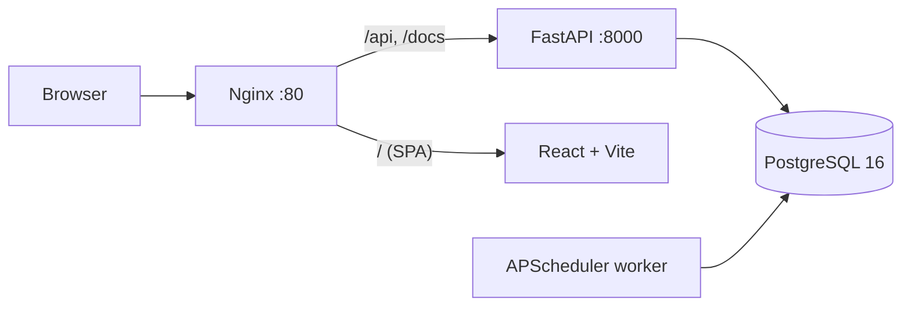
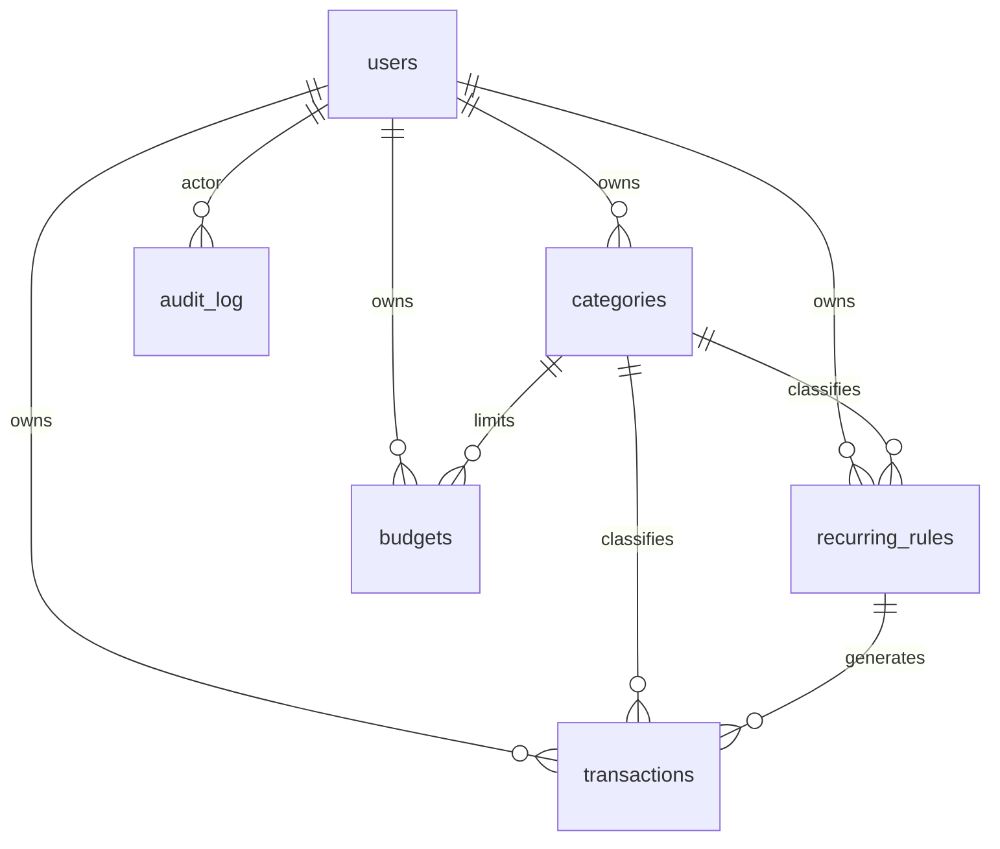

🌐 **English** · [Русский](README.ru.md)

# Finance Tracker

A full-stack personal-finance application: multi-currency accounting, per-category budgets, scheduled recurring transactions, CSV import/export with column mapping, and a complete change-audit trail — all running end-to-end from a single `docker compose up`.

[](https://github.com/lenar-e/finance-tracker/actions/workflows/ci.yml)


---

## Overview

Finance Tracker lets a user record income and expenses, group them into custom categories, set monthly budgets, and understand where their money goes through a charts dashboard. Two isolated demo accounts ship with the app, each seeded with ~400 realistic transactions across six months.

What makes it more than a CRUD demo:

- **Multi-currency done correctly** — every transaction stores its original amount *and* the exchange rate at the time it happened; the base-currency value is a database **generated column**, so totals can never drift out of sync with the source data.
- **Money-grade correctness** — `NUMERIC` everywhere (no floats), positive-amount `CHECK` constraints, half-open date ranges for filters, and divide-to-zero guards on currency re-basing.
- **Auditable by design** — every create / update / delete of a transaction, category or budget is logged with the acting user, timestamp, and full before/after JSON snapshots.
- **One command to run** — `docker compose up` brings up the database, API, background scheduler, and web app together; the database is migrated and seeded automatically on first boot.

> This project also demonstrates an **architecture-first, AI-assisted workflow** — see [AI-Assisted Development](#ai-assisted-development).

---

## Screenshots

<!--
  Portfolio tip: drop 2–4 screenshots or a short GIF here.
  Recommended: Dashboard (charts), Transactions (filters), Budgets (progress bars), Audit Log (before/after diff).
  Example:
  
  
-->

_Add screenshots / a demo GIF here — the dashboard, transactions with filters, budget progress bars, and the audit-log diff view make the strongest impression._

---

## Features

| Area | Capabilities |
|---|---|
| **Transactions** | CRUD with server-side filtering by date range, category, type, currency, and amount range; pagination with total counts; original-currency amount + stored rate |
| **Categories** | CRUD with icon & color; soft-delete (archive) so historical transactions never break |
| **Budgets** | Monthly per-category limits with live progress bars (green / amber / red) computed against actual spend |
| **Recurring** | Rules (salary, subscriptions) materialized into real transactions by a scheduled background worker |
| **Dashboard** | Income/expense/balance summary, expenses-by-category donut, 6-month income-vs-expense trend, top-5 categories |
| **Import / Export** | CSV export of filtered transactions; CSV import with **column mapping** (load raw bank exports without manual editing) and dry-run preview |
| **Multi-currency** | Per-user base currency; re-basing existing data via a user-supplied rate; per-transaction historical rates |
| **Auth** | JWT access + refresh tokens with **server-side refresh-token rotation**; strict per-user data isolation |
| **Audit log** | Full change history with before/after JSON, actor, IP, and timestamp; filterable, paginated UI |

---

## Tech Stack

| Layer | Technologies |
|---|---|
| **Backend** | Python 3.12 · FastAPI · SQLAlchemy 2.0 (async) · asyncpg · Alembic · Pydantic v2 · python-jose (JWT) · passlib/bcrypt · APScheduler |
| **Database** | PostgreSQL 16 (generated columns, `CHECK` constraints, `JSONB`, `INET`, partial unique indexes) |
| **Frontend** | React 18 · TypeScript 5 (strict) · Vite 5 · TanStack Query · Zustand · React Router 6 · Tailwind CSS 3 · Chart.js |
| **Infrastructure** | Docker Compose · Nginx (multi-stage build, SPA fallback, API/Swagger proxy) |
| **Quality** | pytest + pytest-asyncio (21 integration tests) · ruff · ESLint · `tsc --noEmit` · GitHub Actions CI |

---

## Architecture



Five services compose the system: `postgres`, `backend` (FastAPI), `scheduler` (APScheduler in its own container), `nginx` (serves the built SPA in prod / proxies Vite in dev), and a dev-only `frontend` (Vite HMR). The scheduler is health-check-gated behind the backend so migrations always complete before it starts.

### Data model



Eight tables: `users`, `categories`, `transactions`, `recurring_rules`, `budgets`, `exchange_rates`, `refresh_tokens`, `audit_log`. Full column-level schema, indexes, and the complete endpoint list live in **[ARCHITECTURE.md](ARCHITECTURE.md)**.

---

## Getting Started

**Prerequisites:** Docker Desktop (or Docker Engine + Compose v2).

```bash
git clone https://github.com/lenar-e/finance-tracker.git
cd finance-tracker
cp .env.example .env
docker compose up --build
```

On first boot the backend runs migrations and seeds realistic demo data automatically — no extra steps.

| Service | URL |
|---|---|
| Web app | http://localhost:5173 (also proxied at http://localhost) |
| API | http://localhost:3000 |
| Swagger / OpenAPI | http://localhost:3000/docs |

**Demo accounts** (seeded):

| Email | Password |
|---|---|
| `personal@example.com` | `password123` |
| `family@example.com` | `password123` |

---

## Engineering Highlights

A few decisions that go beyond the happy path (full reasoning in [report/REPORT.md](report/REPORT.md)):

- **`amount_base` as a generated column.** `GENERATED ALWAYS AS (amount * exchange_rate) STORED` means the base-currency value is owned by the database. There is no Python code path that can write a stale total, and changing the base currency is a single bulk `UPDATE` of rates — Postgres recomputes the rest.

- **Refresh-token rotation.** Refresh tokens are persisted by their `jti`; each refresh revokes the old token and issues a new one, so reuse of a stolen token is detectable and logout is genuinely server-side. The Axios client funnels concurrent 401s through a single shared refresh promise to avoid a refresh race.

- **Audit log in the service layer, not DB triggers.** The authenticated `user_id` lives in the request/JWT context, which database triggers can't see. Writing audit records in the service layer captures the real actor alongside before/after `JSONB` snapshots.

- **Isolated scheduler service.** Recurring transactions are generated by APScheduler in a separate container, health-check-gated behind the backend and wrapped in a startup retry loop — background work can't block or crash the API, and it won't race migrations.

- **Correctness in the details.** The audit date filter uses a half-open interval (`occurred_at < to + 1 day`) to fix an off-by-one that dropped same-day records; currency re-basing clamps divisions with `GREATEST(…, min_unit)` so they can't violate the positive-amount `CHECK`; list pagination issues a `COUNT` over the filtered subquery so totals reuse every filter without duplication.

---

## Testing & CI

GitHub Actions runs on every push and PR:

- **Backend** — `ruff` lint + `pytest` (21 integration tests) against a real PostgreSQL 16 service container.
- **Frontend** — `tsc --noEmit` type check, ESLint (`--max-warnings 0`), and a production `vite build`.

Lint and type errors **block** the pipeline — there are no `|| true` escape hatches.

```bash
# Backend tests locally
cd backend && pytest -v

# Frontend checks locally
cd frontend && npm run lint && npx tsc --noEmit && npm run build
```

---

## Project Structure

```
finance-tracker/
├── backend/            # FastAPI app: models, schemas, routers, services, scheduler, tests, Alembic
├── frontend/           # React + TS + Vite: pages, api clients, hooks, stores, components
├── docker/             # Nginx (prod + dev configs) and Postgres init
├── docker-compose.yml  # Base (production) stack
├── docker-compose.override.yml  # Dev overrides (hot reload, Vite)
├── ARCHITECTURE.md     # Source of truth: DB schema, endpoints, infra
└── report/             # Development journal & prompt history
```

---

## API

The REST API (~40 endpoints across 10 domains) is fully documented via OpenAPI and browsable in **Swagger UI** at `http://localhost:3000/docs`. Every route except `/auth/*` requires a `Bearer` access token and is scoped to the authenticated user. See [ARCHITECTURE.md § REST API](ARCHITECTURE.md#3-rest-api-endpoints) for the full reference.

---

## AI-Assisted Development

This project was built with an **architecture-first, AI-assisted workflow** using Claude Code — a deliberate experiment in how far a disciplined human-in-the-loop process can go.

**How it worked:**

1. **Design before code.** A complete `ARCHITECTURE.md` (DB schema, endpoint list, Docker topology, staged plan) was written and committed *before* implementation began — verifiable in the git history — and treated as the single source of truth throughout.
2. **Prompt-driven, review-gated.** Features were generated from precise, scoped prompts (the full log lives in [report/PROMPTS.md](report/PROMPTS.md)), then reviewed, tested, and corrected by hand.
3. **Debugging stayed human.** The non-obvious bugs were diagnosed from first principles — e.g. a Pydantic v2 `IPv4Address → str` serialization failure on the `INET` column, a Docker migration race between `backend` and `scheduler`, and a divide-to-zero violating a `CHECK` constraint during currency conversion. These are documented with root-cause analysis in [report/REPORT.md](report/REPORT.md).

**What this demonstrates:** the ability to drive an AI coding agent effectively — decomposing work, specifying contracts, reviewing generated code critically, and owning correctness, security, and infrastructure end-to-end. The engineering judgment (generated columns, token rotation, audit strategy, service isolation) is the point; the AI was the tool.

---

## Documentation

| File | Contents |
|---|---|
| [ARCHITECTURE.md](ARCHITECTURE.md) | DB schema, directory structure, REST API, Docker Compose topology |
| [report/REPORT.md](report/REPORT.md) | Development journal — decisions, bugs, and root-cause analyses |
| [report/PROMPTS.md](report/PROMPTS.md) | Full history of prompts used during development |

---

<sub>Built by [Lenar Evstafev](https://github.com/lenar-e). Backend · Frontend · Infrastructure.</sub>
